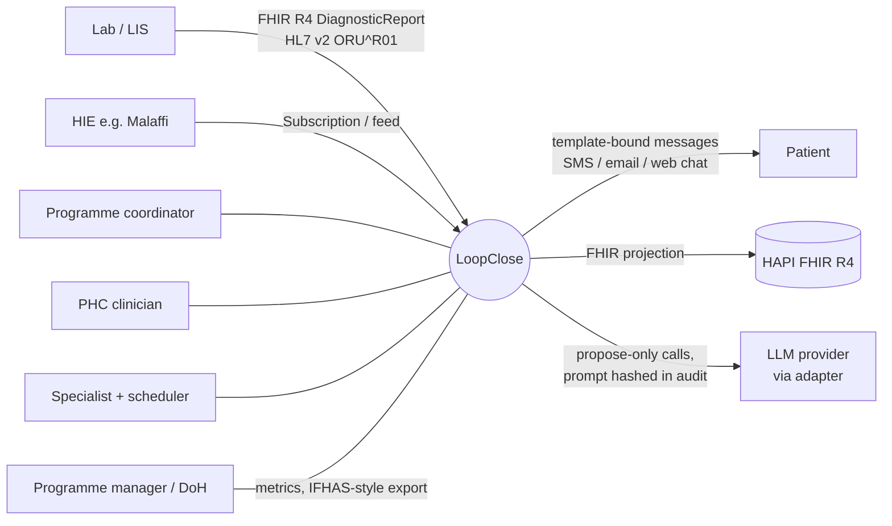
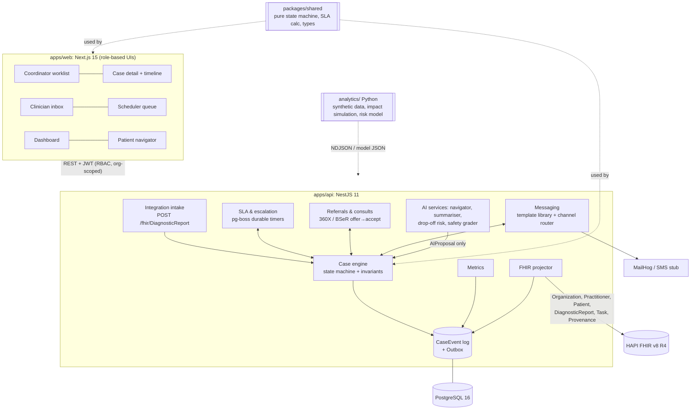
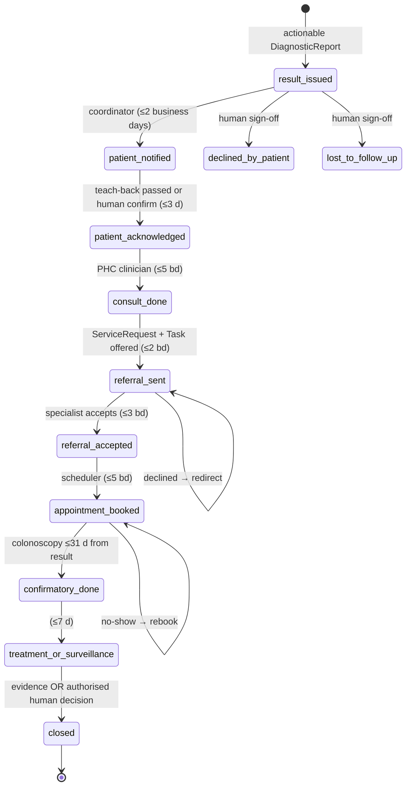

# LoopClose architecture

LoopClose is a closed-loop results-management platform. Every actionable screening result becomes a **case**: a state machine with a named accountable owner at every step, SLA clocks, human-governed escalation and evidence-gated closure. It works across organisations: lab, screening programme, primary care, specialist and hospital. AI sits on top in bounded, propose-only roles.

Decisions are recorded as ADRs in `docs/adr/` (ADR-001 to ADR-008); this page is the overview.

## 1. Context (C4 level 1)

## 2. Containers (C4 level 2)

| Container | Technology | Responsibility |
|---|---|---|
| `packages/shared` | TypeScript, zod, 37 unit tests | Pure, side-effect-free case state machine and SLA calendar maths, shared by API and UI so the two cannot drift |
| `packages/fhir` | TypeScript, `@types/fhir` | FHIR R4 resource builders (Task, Provenance, DiagnosticReport…) |
| `apps/api` | NestJS 11, Prisma 6, pg-boss 10 | Intake, case engine, SLA/escalation, referrals, consults, messaging, AI services, metrics, audit, demo controls |
| `apps/web` | Next.js 15, React 19, Tailwind, Radix | Coordinator, clinician, scheduler, patient and manager views |
| PostgreSQL 16 | Prisma schema (`apps/api/prisma/schema.prisma`) | System of record: cases, immutable event log, outbox, audit log, AI proposals, consent |
| HAPI FHIR v8 (R4) | Docker | Standards-based projection judges and integrators can query directly |
| `analytics/` | Python: numpy, pandas, scikit-learn, simpy | Synthetic population, impact simulation, risk-model training, evals |

## 3. Case lifecycle (colorectal FIT, configured in `config/programmes/colorectal-fit.yaml`)

Breast BI-RADS 4/5 (`breast-birads.yaml`) runs on the same engine with different states, owner roles and SLAs. It is configuration, not code. Every state has `routine`, `priority` and `urgent` SLA variants. SLA values are placeholders until a clinical lead validates them against the DoH/IFHAS programme standard.

## 4. Invariants enforced in code

| Invariant | Where | ADR |
|---|---|---|
| Every non-terminal case has an accountable owner; hand-off is offer → accept, never a silent transfer | `packages/shared/src/machine.ts` (rejects null owner) | ADR-004 |
| `closed` requires evidence of an allowed type **or** an authorised human decision with a reason | state machine + `Evidence` model | ADR-005 |
| AI actors may enter only the states in `aiPolicy.mayEnterStates`, and may never assign owners, close, exit or escalate | state machine guard; covered by unit tests | ADR-006 |
| Every transition is an immutable `CaseEvent` (who, what, when, why, evidence); the audit trail and metrics are derived from it | case engine + outbox | ADR-002 |
| SLA timers survive restarts: warn at 70 %, breach then escalate to a named human role | pg-boss jobs keyed `case:version` | ADR-003 |
| Intake is idempotent on the result identifier | integration controller | ADR-001 |

## 5. AI components (bounded, propose-only)

All model calls go through one choke point, `apps/api/src/modules/ai/llm.client.ts` (ADR-008). It selects the model per feature, logs a **prompt hash, never the raw prompt**, plus model, version and token counts to `AuditLog`. It degrades to template-only or rules-only behaviour when no model is configured. Each feature has a kill switch (`AIFeatureFlag`).

| Feature | What it does | Can it change case state? |
|---|---|---|
| Patient navigator | Picks and personalises clinician-approved templates (ar/en/ur/hi) and asks a teach-back question | Proposes `patient_acknowledged` only when teach-back passes and programme policy allows. Nothing else |
| Hand-off summariser | Drafts a referral/eConsult summary from structured fields | No. Draft for a clinician to edit and approve |
| Drop-off risk | Interpretable logistic model (`analytics/output/risk_model.json`) giving a tier and top-3 reasons | No. Prioritises outreach and can trigger a human escalation |
| Safety grader | Rules-first pre-send check on every outbound message (no diagnosis or probabilities, correct language, urgency not contradicted) | No. Fails closed: a blocked message is never sent |

## 6. Deployment view

- **Local / judges:** `docker compose up` (Postgres, HAPI, MailHog) and `pnpm dev`; seeders load the synthetic population.
- **Pilot target:** in-country cloud (e.g. Azure UAE North) on container apps with managed Postgres, TLS and secrets in a key vault. The LLM endpoint is in-region through the adapter, or disabled (template-only mode).
- **Scaling:** stateless API replicas; pg-boss workers scale with replicas; HAPI has its own database; read replicas serve metrics. See `docs/integration-guide.md`.
